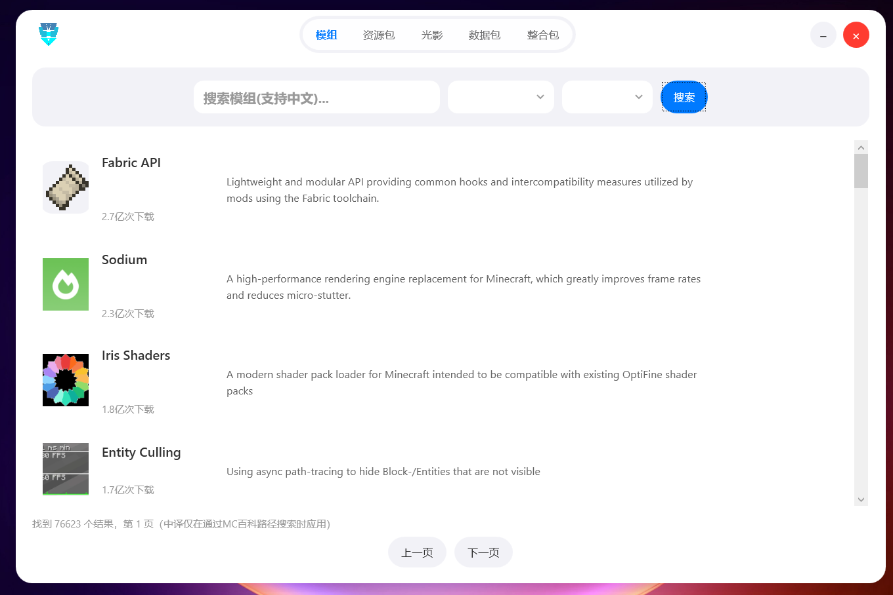

<h1 align="center">Wpfhw</h1>

<p align="center">
  <strong>一个用 Modrinth API 制作的 Modrinth 资源下载器</strong>
</p>

<p align="center">
  <a href="https://github.com/HW-Community/Wpfhw/stargazers">
    
  </a>
  <a href="https://github.com/HW-Community/Wpfhw/network/members">
    
  </a>
  <a href="https://github.com/HW-Community/Wpfhw/blob/main/LICENSE">
    
  </a>
</p>

Wpfhw 是一款基于 WPF 构建的 Windows 桌面应用，通过 [Modrinth API](https://docs.modrinth.com) 帮你搜索、浏览和下载 Minecraft 模组、整合包、资源包和光影包。告别浏览器里来回翻页的繁琐操作，在一个窗口里完成从检索到下载的全部流程。

---

## 目录

- [功能特性](#功能特性)
- [截图预览](#截图预览)
- [下载与安装](#下载与安装)
- [使用说明](#使用说明)
- [技术栈](#技术栈)
- [本地开发](#本地开发)
- [参与贡献](#参与贡献)
- [开源协议](#开源协议)
- [致谢](#致谢)

---

## 功能特性

- **资源搜索** — 关键词检索 Modrinth 全站资源，支持按下载量、关注数、更新时间等维度排序
- **多类型支持** — 模组（mod）、整合包（modpack）、资源包（resourcepack）、光影包（shader）一网打尽
- **精细筛选** — 按游戏版本、加载器（Fabric / Forge / Quilt / NeoForge 等）、分类标签过滤结果
- **版本管理** — 查看每个项目的全部历史版本，按游戏版本和加载器筛选可用文件
- **一键下载** — 选中版本即可直接下载到本地，无需跳转浏览器
- **现代 UI** — v26.1.1 全新界面设计与视觉美化，操作流畅直观
- **原生体验** — 纯 WPF 桌面应用，启动快、占用低，离线浏览已缓存的项目信息

## 截图预览

> v26.1.1 新版界面



<!-- 将截图文件放入仓库的 screenshots/ 目录，并替换上方文件名即可 -->

## 下载与安装

### 系统要求

- Windows 10 1809 及以上版本
- 屏幕分辨率不低于 1280×720
- 框架依赖版需要 [.NET 10 Desktop Runtime x64](https://dotnet.microsoft.com/download/dotnet/10.0/runtime)；自包含单文件版无需安装 .NET

### 获取最新版本

前往 [Releases 页面](https://github.com/HW-Community/Wpfhw/releases) 下载最新发行版：

1. 找到标记为「最新」的版本
2. 下载附件中的安装包或便携版压缩包
3. 安装版双击运行 `.exe` 安装；解压后直接运行 `Wpfhw.exe`

### 首次启动

首次打开应用时无需额外配置，程序会自动连接 Modrinth API。如遇网络问题，请检查代理设置是否正确。

## 使用说明

### 搜索资源

在顶部搜索栏输入关键词（如 `sodium`、`fabric api`），选择资源类型和筛选条件后点击搜索，结果列表会展示项目名称、简介、下载量和图标。

### 下载文件

1. 点击搜索结果中的项目卡片，进入详情页
2. 在版本列表中按游戏版本和加载器筛选
3. 选择目标版本，点击下载按钮
4. 文件将保存到应用设定的下载目录中（可在设置中修改默认路径）

### 常见操作

| 操作 | 说明 |
|------|------|
| 修改下载路径 | 设置 → 下载目录 |
| 切换资源类型 | 搜索栏旁的下拉菜单 |
| 查看项目主页 | 详情页点击「在 Modrinth 查看」 |

## 技术栈

| 层级 | 技术 |
|------|------|
| UI 框架 | WPF（Windows Presentation Foundation） |
| 开发语言 | C# |
| 运行时 | .NET 10（框架依赖版需安装 Desktop Runtime；自包含版已内置） |
| API 对接 | Modrinth API v2（`https://api.modrinth.com/v2`） |
| HTTP 请求 | `HttpClient` / RESTful 调用 |
| 数据格式 | JSON |

### Modrinth API 要点

Wpfhw 基于以下核心接口实现功能：

- `GET /v2/search` — 按关键词搜索项目，支持 facets 多维过滤和排序
- `GET /v2/project/{id|slug}` — 获取项目详情
- `GET /v2/project/{id|slug}/version` — 获取项目的全部版本列表
- `GET /v2/version_file/{hash}` — 通过文件哈希查询版本信息

API 要求所有请求携带唯一标识的 `User-Agent` 头，格式建议为 `HW-Community/Wpfhw/版本号`。完整文档参见 [Modrinth API 文档](https://docs.modrinth.com)。

## 本地开发

### 环境准备

- Windows 10/11
- [.NET 10 SDK](https://dotnet.microsoft.com/download/dotnet/10.0)（x64）
- Visual Studio 2022 或 2026（工作负载：使用 C++ 的桌面开发，含 Windows SDK）

### 构建步骤

在仓库根目录运行 `build.bat`（`wpfhw\build.bat` 与 `native\build.bat` 都会转到根目录脚本）：

```bat
build.bat
```

默认构建 Release 并一次产出三种发布形态。也可以指定配置和形态：

```bat
build.bat Release all
build.bat Release self
build.bat Release fx-single
build.bat Release fx-full
build.bat Debug all
```

| 形态 | 产物 | 目标机要求 |
|------|------|-----------|
| `self` | `dist\Release\self-contained-single\Wpfhw.exe` | 无需安装 .NET |
| `fx-single` | `dist\Release\framework-single\Wpfhw.exe` | .NET 10 Desktop Runtime x64 |
| `fx-full` | `dist\Release\framework-full\` | .NET 10 Desktop Runtime x64 |

WPF 主程序会把 native 的托盘/CLI 组件作为资源嵌入，单文件产物仍然只有一个 exe；首次运行时释放到 `%LOCALAPPDATA%\Wpfhw\native\`。native 独立工具仍会编译到 `native\bin\Release\Wpfhw.exe`。

命令行用法（三种发布形态均可用）：

```bat
dist\Release\framework-single\Wpfhw.exe search sodium
dist\Release\framework-single\Wpfhw.exe download fabric-api
```

## 参与贡献

欢迎提交 Issue 和 Pull Request。

1. Fork 本仓库
2. 创建功能分支（`git checkout -b feature/your-feature`）
3. 提交更改（`git commit -m 'feat: 添加某个功能'`）
4. 推送到分支（`git push origin feature/your-feature`）
5. 发起 Pull Request 并描述改动内容

提交信息建议遵循 [Conventional Commits](https://www.conventionalcommits.org) 规范。

## 开源协议

本项目采用 [Mozilla Public License 2.0](LICENSE) 开源。

## 致谢

- [Modrinth](https://modrinth.com) — 提供 Minecraft 模组分发平台及开放的 REST API
- [Modrinth API 文档](https://docs.modrinth.com) — 完整的接口参考
- 所有为本项目提出建议和反馈的用户

---

<p align="center">Made with ❤️ by HW-Community</p>
